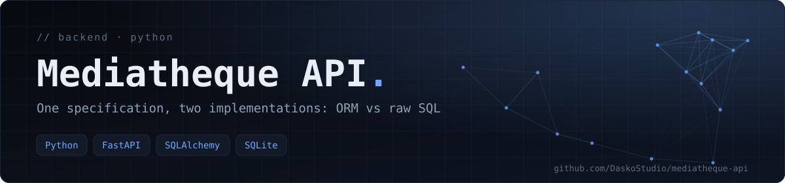
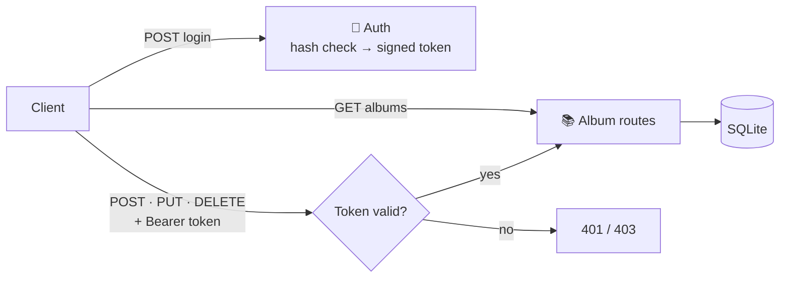

<div align="center">



**A REST API for managing a music-album library, built **twice** with FastAPI to compare two ways of accessing data: an ORM (SQLAlchemy) versus raw SQL (`sqlite3`).**

   

[Features](#-features) · [Getting started](#-getting-started) · [Tech stack](#-tech-stack)

</div>

## 🧬 Two implementations, one specification



Both versions expose the same album CRUD and the same authentication flow; only the internals differ.

| | Version A | Version B |
|---|---|---|
| Folder | [`version_a_sqlalchemy/`](version_a_sqlalchemy/) | [`version_b_sqlite_brut/`](version_b_sqlite_brut/) |
| Data access | SQLAlchemy ORM | Native `sqlite3`, hand-written SQL |
| Password hashing | bcrypt (passlib) | PBKDF2-SHA256, 200,000 iterations, per-user salt |
| Auth token | JWT (python-jose), HS256, 30 min | Signed token (itsdangerous), 30 min |
| Login route | `POST /login` (OAuth2 form) | `POST /connexion` (JSON) |

Each folder has its own README, tests and `requirements.txt`.

## ✨ Features

- Full CRUD on albums with the correct status codes (`201`, `404`, `204`).
- **Public reads, protected writes** — listing and reading are open; create, update and delete require a token.
- Input validation: non-empty title and artist, rating between 0 and 10, plausible year, genre from a fixed list (`422` otherwise).
- An internal field (who or when an album was added) that is **stored but never returned** by the API.
- Persistent SQLite storage.
- A default account created at first start, configured through environment variables.

## 🔌 API overview

| Method | Path | Access | Description |
|---|---|---|---|
| GET | `/albums` | public | List all albums |
| GET | `/albums/{id}` | public | Read one album (`404` if missing) |
| POST | `/albums` | authenticated | Create an album (`201`) |
| PUT | `/albums/{id}` | authenticated | Update an album |
| DELETE | `/albums/{id}` | authenticated | Delete an album (`204`) |
| POST | `/login` · `/connexion` | public | Obtain a token (version A · version B) |

Interactive documentation is served at `/docs` (Swagger UI).

## 🚀 Getting started

```bash
# Version A — SQLAlchemy
cd version_a_sqlalchemy
python3 -m venv .venv && source .venv/bin/activate
pip install -r requirements.txt
uvicorn app.main:app --reload
```

```bash
# Version B — raw SQLite
cd version_b_sqlite_brut
python3 -m venv .venv && source .venv/bin/activate
pip install -r requirements.txt
uvicorn main:app --reload
```

Then open <http://127.0.0.1:8000/docs>.

## ⚙️ Configuration

Secrets are never hard-coded. Copy `.env.example` to `.env` in the version you run and set your own values (see each version's README for the variable names). Without a `.env`, the code falls back to development-only defaults that must not be used in production.

## 🛡️ Security

- Passwords are stored as hashes — never in clear text.
- Tokens are signed and expire after 30 minutes.
- Configuration comes from environment variables; `.env` files are git-ignored.

## 🧪 Tests

```bash
pytest
```

Each version ships two tests: authenticated creation succeeds, and creation without a token is rejected.

## 🧰 Tech stack

Python · FastAPI · Pydantic v2 · SQLAlchemy · SQLite · Pytest

---

<div align="center">

<sub>Built by <a href="https://github.com/DaskoStudio"><b>Konaté Adama</b></a> · <a href="https://github.com/DaskoStudio?tab=repositories">More projects</a></sub>

</div>
